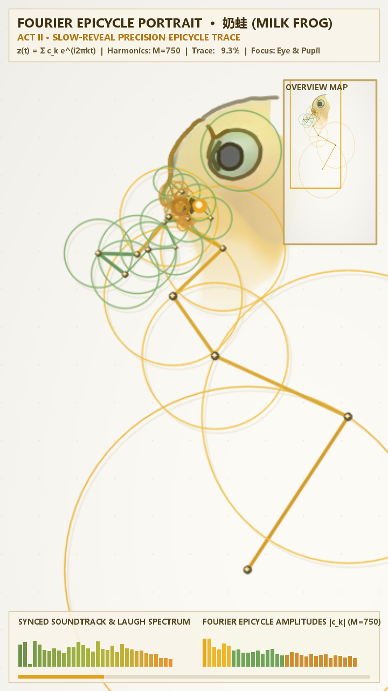
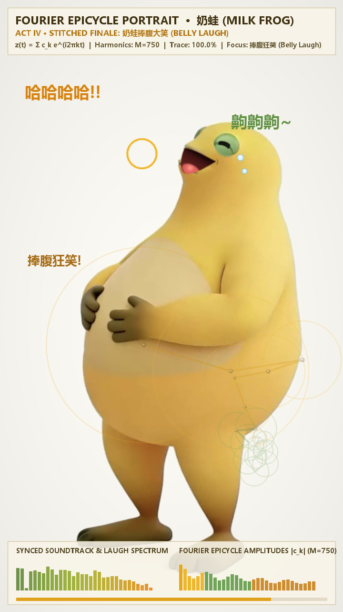

# 奶蛙傅里叶动画 · Milk Frog Fourier Animation

从一张奶蛙参考图出发，用傅里叶本轮（epicycles）描绘轮廓，逐步显露原图，再衔接配乐与捧腹大笑动画。

项目使用 Python 完成轮廓提取、闭环拼接、音频合成与逐帧渲染，通过 FFmpeg 输出 **28.8 秒、720×1280、30 fps** 的竖屏视频，并额外导出大笑片段的循环 GIF。

## 效果预览

| 傅里叶轨迹与局部跟随 | 捧腹大笑片段 |
| --- | --- |
|  |  |

完整 MP4 和 GIF 由本地运行生成，不包含在源码仓库中。

## 浏览器互动版

**双击打开 [`web/index.html`](web/index.html)**，即可体验无需 Python、无需安装前端依赖的互动动画。请保留完整的 `web/` 文件夹。

- 播放、暂停、拖动进度或直接跳转四幕。
- 实时调整 4–750 个傅里叶项，查看简化轮廓与精细描绘的差别。
- 调节速度，开关本轮、轨迹与相机跟随。
- 点击奶蛙或大笑按钮，开启声音并进入大笑片段。
- 支持手机布局、键盘操作和循环播放。


需要单个文件分享时，可导出包含图像、动画帧和音轨的 HTML：`output/web/naiwa_fourier_playground.html`。生成方式、复现范围及浏览器测试见 [HTML 演示说明](docs/WEB_DEMO.md)。

## 实现内容

- **轮廓处理**：提取外轮廓与内部特征，将多个轮廓拼接成闭合路径，等弧长重采样为 4,096 个点。
- **傅里叶描绘**：通过 FFT 计算复数系数，保留 750 项（含直流项），显示旋转圆、笔尖轨迹与全景小地图。
- **分幕动画**：从简到繁展示谐波，放大跟随描绘位置，逐步显影参考图，最后进入大笑片段。
- **声画同步**：合成 44.1 kHz 立体声配乐与共振峰笑声，并生成音频频谱、嘴部与身体变形的逐帧同步曲线。
- **视频导出**：使用 H.264 / AAC 编码 MP4，同时保存 GIF 与关键帧预览。

动画保留了参考图的泥塑外观；实现方式是二维图像合成与 OpenCV 网格变形。图像阈值、特征坐标和变形区域针对随附参考图编写，尚未实现任意图片自动适配。

## 快速开始

需要可用的 **Python、FFmpeg 和中文字体**。已在 Windows、Python 3.13.9、FFmpeg 7.1 环境完成运行验证；其他系统的路径与字体候选已在代码中提供，尚未实机验证。

在项目根目录打开终端。

### Windows PowerShell

```powershell
python -m venv .venv
.\.venv\Scripts\python.exe -m pip install -r requirements.txt
ffmpeg -version
.\.venv\Scripts\python.exe run_all.py
```

### macOS / Linux

```bash
python3 -m venv .venv
./.venv/bin/python -m pip install -r requirements.txt
ffmpeg -version
./.venv/bin/python run_all.py
```

FFmpeg 是独立程序，需要单独准备并放入当前终端的 `PATH`；`pip install -r requirements.txt` 不会安装它。中文字体设置、分步执行和故障排查见 [使用说明](docs/USAGE.md)。

## 输出文件

| 文件或目录 | 内容 |
| --- | --- |
| `output/naiwa_fourier_epicycle_reveal.mp4` | 28.8 秒竖屏视频，含配乐与合成笑声 |
| `output/naiwa_belly_laugh.gif` | 360×660 的大笑片段循环动图，无音轨 |
| `output/previews/` | 描绘、显影、过渡与大笑阶段截图 |
| `output/data/` | 闭环采样数据与逐帧同步曲线 |
| `output/audio/naiwa_soundtrack.wav` | 44.1 kHz、16 位立体声音频 |
| `output/diagnostics/` | 手动运行辅助工具后生成的诊断图 |

脚本会自动创建所需输出目录。重复运行会覆盖对应的同名生成文件。

## 项目结构

```text
.
├── assets/                  # 输入参考图
├── scripts/                 # 轮廓、音频、视频三步生成管线
├── tools/                   # 轮廓、傅里叶重建与变形姿态可视化
├── web/                     # 可直接打开的浏览器互动版与必要资源
├── tests/                   # 可选的浏览器交互验证
├── docs/                    # 使用、原理、结构与上传说明
│   └── images/              # 精选效果截图
├── output/                  # 本地生成物，Git 忽略
├── run_all.py               # 一键运行入口
├── requirements.txt         # Python 依赖
├── .gitattributes           # 文本换行与二进制文件规则
└── .gitignore
```

脚本按自身位置定位项目根目录，不依赖启动时的工作目录。详细职责及原文件迁移映射见 [项目结构](docs/PROJECT_STRUCTURE.md)。

## 文档导航

- [使用说明](docs/USAGE.md)：依赖、FFmpeg、字体、分步生成、辅助工具和常见问题。
- [HTML 演示说明](docs/WEB_DEMO.md)：互动操作、浏览器素材、单文件导出与测试。
- [生成原理](docs/PIPELINE.md)：轮廓拼接、傅里叶表达、音频同步与四幕时序。
- [项目结构](docs/PROJECT_STRUCTURE.md)：目录职责、路径约定和旧文件位置对照。
- [上传 GitHub](docs/PUBLISHING.md)：首次提交、忽略规则与远程仓库设置。
