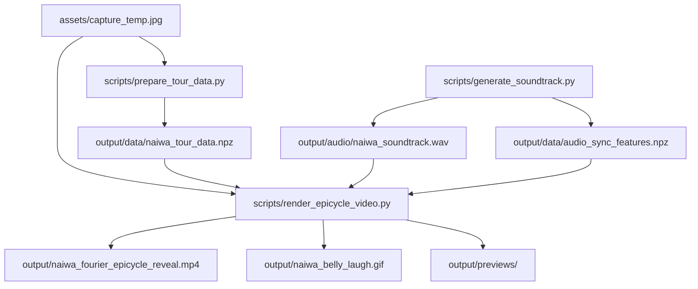

# 生成原理与数据流

[返回 README](../README.md) · [操作步骤](USAGE.md)

## 整体数据流



`run_all.py` 是流程调度入口，各阶段仍可作为独立脚本运行。三个辅助工具直接读取参考图，生成供人工查看的诊断图。

## 轮廓提取与闭环拼接

[prepare_tour_data.py](../scripts/prepare_tour_data.py) 使用 HSV 中的饱和度和亮度生成前景掩码，结合形态学开闭运算减少噪声和断裂。最大外轮廓作为主体边界，经平滑后把头顶附近设为起点，并检查行进方向。

内部特征来自 Lab 各通道的 Canny 边缘，以及单独处理的腹部边界。代码屏蔽外边缘附近的重复线段，再按连通区域面积和轮廓点数筛选内部轮廓；轮廓数量由实际提取结果决定。

之后逐次寻找当前路径与剩余内部轮廓的近邻连接，将往返桥接段插入路径。桥接点使用 `is_bridge` 标记，重采样后形成 `ubridge`，供后续显影与描绘使用。

最终沿累计弧长重采样为 4,096 个点，写入 `output/data/naiwa_tour_data.npz`。

| 字段 | 内容 |
| --- | --- |
| `ux`、`uy` | 等弧长采样点在参考图中的横纵坐标 |
| `ubridge` | 采样点是否属于轮廓间的桥接区域 |
| `w`、`h` | 参考图宽度与高度 |

## 傅里叶本轮表达

渲染阶段将采样坐标映射到画布，以画布参考中心为原点组成复数序列 `z = x + iy`，通过 `np.fft.fft(z) / N` 得到系数。

对于归一化路径参数 `u`，使用保留的系数近似重建：

```text
z(u) ≈ Σ c_k · exp(i · 2π · k · u)
```

每一项都可以解释为一个旋转向量：半径为 `|c_k|`、转速由频率 `k` 决定。向量依次累加形成本轮链，最后一个端点作为笔尖。

代码单独保留直流项，再将非直流系数按幅值排序。`MAX_M = 750` 表示总共最多保留 750 项，其中含一个直流项，并非最高频率为 750。开场依次使用 4、10、24、65、180、750 项，展示细节逐步增加的过程。

## 配乐、合成笑声与同步数据

[generate_soundtrack.py](../scripts/generate_soundtrack.py) 以 44,100 Hz 采样率合成 28.8 秒立体声：

- 由和弦、铺底音色、钟琴式拨奏、旋律与打击声构成配乐。
- 通过谐波声源、气声和带通滤波构造类似“哈”“齁”的合成笑声。
- 加入卷积混响、淡入淡出与软限幅，再写出 16 位 WAV。
- 按 30 fps 生成 864 帧的 RMS、32 频带频谱与身体变形曲线。

笑声不是录音或文本转语音服务的输出。笑声合成和角色变形共享 `laugh_syllables` 时间表，从而把嘴部张开和身体抖动与笑声脉冲对齐。

`output/data/audio_sync_features.npz` 的主要字段：

| 字段 | 形状 | 用途 |
| --- | --- | --- |
| `fps`、`n_frames` | 标量 | 帧率与总帧数 |
| `frame_rms` | `(864,)` | 逐帧能量包络 |
| `frame_spec` | `(864, 32)` | 32 频带可视化数据 |
| `laugh_mouth`、`laugh_squint` | 各 `(864,)` | 嘴部张开与眯眼 |
| `laugh_lean`、`laugh_head` | 各 `(864,)` | 身体后仰与头部倾斜 |
| `laugh_belly_inf`、`laugh_belly_dy` | 各 `(864,)` | 腹部膨胀与上下位移 |
| `laugh_hand`、`laugh_bounce` | 各 `(864,)` | 手部动作与整体弹跳 |

以上形状对应当前默认参数；变更时长或帧率后会随之变化。

## 四幕时间线

| 时间 | 阶段 | 主要画面 |
| --- | --- | --- |
| 0.0–6.0 秒 | 谐波唤醒 | 每秒增加一档保留项数，展示本轮链与轮廓重建 |
| 6.0–16.8 秒 | 慢速描绘 | 完成一次闭环描绘，相机跟随笔尖，显示全景小地图与渐进显影 |
| 16.8–20.4 秒 | 原图显影与过渡 | 显示完整参考图，19.6 秒起加入点击提示、金色圆环与吸气准备 |
| 20.4–28.8 秒 | 捧腹大笑 | 按笑声时序驱动嘴部、眼部、身体、腹部和手部变形，并加入文字与眼泪 |

点击提示是预先渲染在视频中的视觉效果，导出的 MP4 不接收实际点击事件。

## 图像变形与视频编码

[render_epicycle_video.py](../scripts/render_epicycle_video.py) 在参考图的二维像素坐标上构造局部位移与旋转权重，用 `cv2.remap` 完成面部和身体变形，再绘制口腔、舌头、眼泪、文字和频谱。泥塑质感来自输入图像，不包含三维模型、光照求解或物理仿真。

最终 RGB 帧经标准输入流送往外部 FFmpeg，采用 `libx264`、`yuv420p`、CRF 17、`fast` 预设及 192 kbps AAC 编码，并添加 `+faststart`。脚本减少 FFmpeg 常规日志输出，并检查编码退出码。

GIF 从大笑阶段的原始画布裁剪、隔帧采样，缩放为 360×660 后由 Pillow 写出。它和完整视频并非完全相同的镜头与 HUD 构图。

## 当前边界

- 图像分割、特征定位与变形区域依赖随附参考图的尺寸和位置。
- 阶段时间、乐句和画面布局含固定值，修改时需要协调多个位置。
- 三个 `tools/` 脚本保留独立实验逻辑，不与主渲染结果逐帧等价。
- 音频脚本固定 NumPy 随机种子为 42；这不代表不同依赖版本的所有输出字节完全一致。
